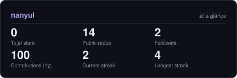

<!-- BANNER - terminal profile.sh --live (animado). Generado por scripts/banner/generate.py.
     Pesa ~0.7 MB cada uno. Agrega ?v=N al nombre si lo regeneras para limpiar la caché. -->
<picture>
  <source media="(prefers-color-scheme: dark)"  srcset="assets/banner-dark.v9.svg">
  <source media="(prefers-color-scheme: light)" srcset="assets/banner-light.v9.svg">
  
</picture>

 

<!-- NOMBRE / TAGLINE - texto animado -->

 

&nbsp;&nbsp;

 

---

## Este es mi espacio :)

¡Hola! Soy **Yuliana**, desarrolladora web desde Costa Rica 🇨🇷.
Me gusta crear interfaces que se vean bien, se sientan fluidas y que cualquiera pueda usar sin complicarse.

- 🎨 Diseño y desarrollo páginas web con **HTML, CSS, JavaScript, TypeScript y React**.
- ⚙️ He trabajado con **Java, C#, PHP y SignalR** en el backend.
- 🧪 Me encanta experimentar con **animaciones web** y detalles visuales.
- 📚 Aprendiendo y construyendo proyectos reales, uno a la vez.
- 🌱 **Mi meta:** seguir creciendo como desarrolladora y compartir lo que aprendo.
- 💬 Hablemos de **diseño web, frontend y proyectos en equipo**.

 

## mi stack

---

## signals

<table>
<tr>
<td width="50%" align="center" valign="middle">

<!-- Radar autoevaluado: edita assets/skills.json y el workflow lo redibuja -->
<picture>
  <source media="(prefers-color-scheme: dark)"  srcset="assets/radar-dark.svg">
  <source media="(prefers-color-scheme: light)" srcset="assets/radar-light.svg">
  
</picture>

</td>
<td width="50%" align="center" valign="middle">

<!-- Radar de stack web: edita assets/langmix.json -->
<picture>
  <source media="(prefers-color-scheme: dark)"  srcset="assets/radar-langs-dark.svg">
  <source media="(prefers-color-scheme: light)" srcset="assets/radar-langs-light.svg">
  
</picture>

</td>
</tr>
</table>

---

## proyectos

| Proyecto | Descripción | Tecnología |
| --- | --- | --- |
| [Encriptador](https://github.com/nanyul/Encriptador) | Encriptador de texto con interfaz web | CSS |
| [GotaVida](https://github.com/nanyul/GotaVida) | Gota de Vida - Proyecto de Diseño de Aplicaciones Web | JavaScript |
| [Subasta_Merakelia](https://github.com/nanyul/Subasta_Merakelia) | Merakelia - Subasta web en línea | JavaScript |
| [Animaciones_Web](https://github.com/nanyul/Animaciones_Web) | Animaciones web con CSS y JavaScript | HTML |
| [Amaretto_Cakes](https://github.com/nanyul/Amaretto_Cakes) | Full-stack .NET con Clean Architecture (API, App, Infra, Web) | C# |

---

## ¿Los números importan? Claro que sí.

<!-- Generado por scripts/cards.py dentro de este mismo repo (no depende de
     github-readme-stats, que a veces se cae). Aparece después de la primera
     corrida del workflow "Charts and cards". -->
<picture>
  <source media="(prefers-color-scheme: dark)"  srcset="assets/card-stats-dark.svg">
  <source media="(prefers-color-scheme: light)" srcset="assets/card-stats-light.svg">
  
</picture>

 

<!-- Generado por el workflow "Metrics" (necesita el secret METRICS_TOKEN) -->

---

` Hecho con cariño · @nanyul `

